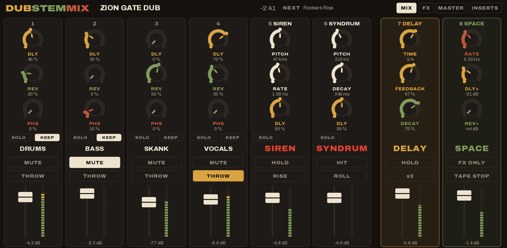
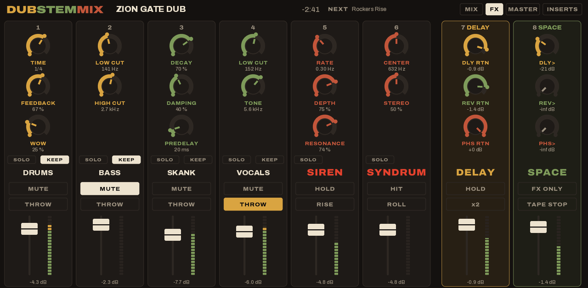
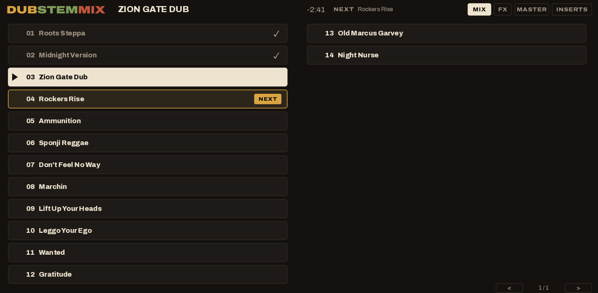
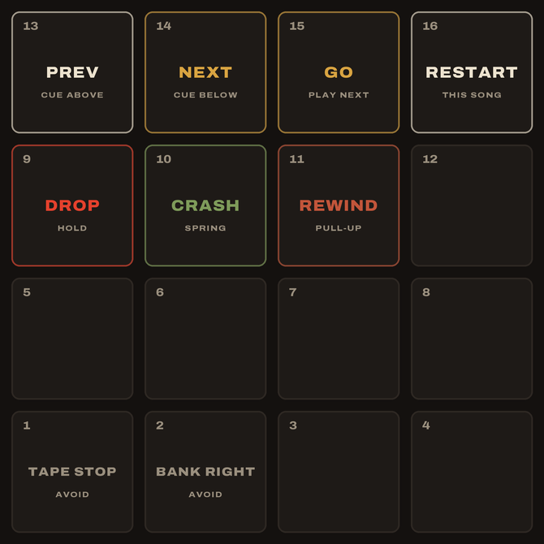
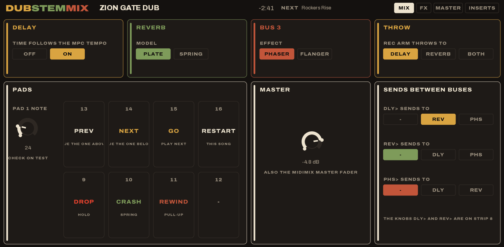

DubStemMix also runs **on an Akai MPC**, as a plugin. Plug the MIDImix into the MPC's USB port and play your set with no computer on stage: the same console, the same effects, the same gestures. The Mac prepares the songs; the MPC plays them.

## What you need

- An **MPC standalone** with **MPC OS 3.10.1** or later. Tested on an **MPC One+**; the plugin is built for every MPC that loads plugins (One, One+, Live, Live II, Live III, X, XL, Key 61, Key 37, Force).
- The **MIDImix**, on its factory mapping, as with the app.
- The **SD card or USB drive** the MPC reads, and DubStemMix on your Mac to put the songs on it.

Akai does not test or support third-party plugins. Save your MPC projects often.

## Put a set on the card

1. In DubStemMix on the Mac, open the setlist.
2. **File ▸ Export Setlist to MPC…**, or right-click the setlist's name ▸ **Export to MPC…**
3. Pick the card in the list (its free room is shown), or **CHOOSE A FOLDER…** to copy it onto the card yourself later.
4. Leave **Back up** ticked if the card already holds a DubStemMix: what is on it is copied first to *Music ▸ DubStemMix ▸ MPC Backups*, in a dated folder.
5. **Export**. The progress shows under the setlist, then **EJECT THE CARD**.

What gets written, in `VST2 Plugins/YoanDev - VST - DubStemMix/` on the card:

- **The plugin**, always the version of your app.
- **One folder per tune**, numbered in the setlist's order, with **one WAV per strip**: the stems the tune already uses, at 44.1 kHz, the MPC's rate. Several stems on one strip are mixed into one file; nothing is separated again.
- **The tune's title, tempo and strip names**, which the MPC shows and uses.

**The card becomes the setlist**: tunes no longer in it go, tunes still in it follow the new order. A tune already on the card and unchanged is **not copied again**, so the second export of a set is almost instant. The first one takes a while: a card writes far slower than your Mac's disk (count about 250 MB per tune).

## First time on the MPC

1. Card in, MPC on. **Preferences ▸ Enhancements (Beta)**: turn on **Enable Enhancements** and **External Plugin Support**, then restart the MPC.
2. Create a **plugin track** and load **DubStemMix** from **External Plugins**.
3. Set the track's **MIDI input** to the MIDImix.

The plugin reads the list of tunes when it loads: after a new export, restart the MPC or load the plugin again.

## The console

The MIDImix plays exactly as with the app: the MIX page with its sends, the dub throw on REC ARM, the effect strips 7 and 8 and their gestures, the siren and the Syndrum on empty strips 5 and 6, **BANK RIGHT** through FX, MASTER and INSERTS, **BANK LEFT** back to MIX, both at once for PANIC, **SOLO** held with MUTE. Knobs catch up with the value before they act, as in the app. See [The board](../the-board/) and [Gestures](../gestures/).

The **CONSOLE** tab mirrors the board. The knobs show what they drive on the current page, MIX, FX, MASTER or INSERTS (the pill at the top right). The plugin cannot light the MIDImix's LEDs on an MPC, so the screen does: MUTE, THROW, HOLD and the other buttons fill in when they are on.

On the screen, touch:

- **KEEP** on a strip, to keep it through DROP;
- **SOLO**, the same as SOLO held with MUTE on the console;
- **NONE / SUB / WAH** on the INSERTS page, to choose a strip's insert.

## Playing a set

The MPC's transport buttons drive the set:

| Button | What it does |
|---|---|
| **PLAY START** | plays the next tune (from the start of the set, the first one) |
| **STOP** | pauses; the echoes and the reverb ring on |
| **PLAY** | resumes where it stopped |

At the end of a tune the next one starts on its own, **with no gap**. The effects and the siren keep sounding while the MPC is stopped.

The **SONG** tab is the setlist. Touch a tune to play it next; touch one already played, or the one playing, to **play it again**. The tune playing is in a cream block, the next one is marked **NEXT**, the ones played for more than 30 seconds are dimmed with a check mark. A long set has pages: ◀ ▶ at the bottom right.

## The pads

The pads of the DubStemMix track play the gestures the app has on the keyboard, and drive the set. They sit on the **two top rows**: on an MPC, pads 1 and 2 send the same notes as the MIDImix's REC ARM 8 and BANK RIGHT, so leave them alone.

- **DROP** (held): every strip not marked KEEP drops out; let go and the mix is back.
- **CRASH**: hits the spring reverb (SETUP ▸ REVERB ▸ SPRING).
- **REWIND**: the pull-up. The tape brakes, the tails stop with it, the tune starts again.
- **PREV / NEXT**: move the NEXT mark up or down the list.
- **GO**: plays the next tune now.
- **RESTART**: the tune playing, from the top; the echoes ring on.

If the pads do nothing, tap pad 1 and read **LAST NOTE** on the TEST tab, then set **PAD 1 NOTE** in SETUP to it.

## Settings

The **SETUP** tab holds what the app has in menus: whether the delay time follows the tempo, plate or spring, phaser or flanger, where REC ARM throws, where DLY> REV> and PHS> send, the master, the pads' note.

A synced delay and the Syndrum's roll follow **the tune's tempo**, exported with it; a tune with no tempo follows the MPC's. Everything you set on the MPC is saved **with the MPC project**, like any plugin: the Mac's effect settings do not travel with the export.

The **TEST** tab shows what reaches the plugin (last CC, note and channel), the start the MPC sent, the plugin's CPU and whether the card ever fell behind (UNDERRUNS, which should stay at 0).

## What stays on the Mac

- **Audio Unit plugins**: the MPC has none of them. The built-in effects all travel.
- **Splitting songs** into stems, and **recording** your session.
- **Pre-fader sends**: on the MPC every send is post-fader. The auto-wah always opens upwards.

## By hand, without the export

Each release also carries **DubStemMix-MPC-<version>.zip** on the [releases page](https://github.com/yoanbernabeu/DubStemMix/releases), with its install notes. Copy the plugin folder into `VST2 Plugins` on the card and add one folder per tune in `Content/Songs`, with 44.1 kHz WAV files named `1 - DRUMS.wav`, `2 - BASS.wav` and so on.

*The pictures of the MPC's screen are drawn from the plugin's own screen files; on the MPC the changing text uses its own fonts.*
