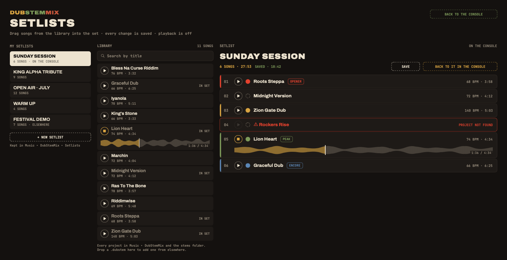

A **project** is one tune, ready to play. A **setlist** is the order of the night. Both are plain files you can copy, move and back up.

## Save a project

<kbd>⌘</kbd> <kbd>S</kbd>, or **SAVE** in the top bar, writes a `.dubstem` file. The first time, you choose where. After that, every change is saved automatically.

A project keeps:

- which stem is on which strip, and the files waiting in the list;
- the effects and their settings, the plugins and their state, the inserts;
- the KEEP marks, the tempo and SYNC, the loop, the title and the strip names, the throw target.

The effect settings include the knobs of the FX and MASTER pages and the returns on faders 7 and 8. It does **not** keep the stem faders, the sends and the master fader: the console is the truth, and SEND ALL brings the screen in line with it.

Files are referenced both by their full path and relative to the project: move the whole folder elsewhere and the project still opens.

- **Rename a tune**: double-click its title in the top bar.
- **Open Recent** (File menu, or right-click the Dock icon): the last 10 projects and setlists.
- **NEW** starts from scratch: empty strips, factory effect settings.

## Build a set: the setlist workshop

**EDIT** at the top of the setlist in the sidebar, or File ▸ Setlists…, opens the workshop in place of the console. While playing, the app asks first and stops playback; your session stays open behind it.



Three columns:

### My setlists

Every setlist kept in `Music/DubStemMix/Setlists`. Create, rename (double-click), duplicate, delete (to the Trash: the songs themselves are not touched). A setlist kept elsewhere shows as `ELSEWHERE` and can be moved into the folder.

### The library

Every project found in `Music/DubStemMix` and in your stems folder, with its tempo and length, and a search by title. The songs from [Prepare songs](../stems/#prepare-a-whole-set-at-once) are here. Drop a `.dubstem` from the Finder onto the library to add one kept elsewhere: the library remembers it.

### The setlist

- **Add**: drag a song from the library onto a line to put it there, anywhere else in the column to add it at the end. Double-click in the library works too.
- **Reorder**: drag the lines.
- **Remove**: <kbd>⌫</kbd> or right-click.
- **No doubles**: a song already in the set blinks instead of being added twice.
- **Colour and tag**: click the dot for a colour, right-click for a tag ("opener", "peak", "rewind"). They belong to this set only: the same song can open one set in red and close another in green.

**▶** on a line plays the song's stems raw, without effects, on the console's output (so on the sound system, if it is plugged in). Click its waveform to jump.

Every change is saved at once (`SAVED · 18:42`). **LOAD IN THE CONSOLE** makes this setlist the console's and goes back to it, without opening a song: press <kbd>N</kbd> or click a line to start.

## The setlist in the sidebar

During the set, the sidebar shows the setlist and its total length.

- **Stopped**: <kbd>N</kbd> / <kbd>P</kbd> or a click load the next or previous tune, at the top, ready to play.
- **Playing**: they **arm** the next tune instead. See [Playing live](../live/).
- Drag `.dubstem` files from the Finder onto it to add them at the end.

### The setlist's rack

In a setlist, what is patched on the buses (the reverb and bus 3 effects, the bus-to-bus sends, the plugins on the buses) belongs to the **setlist**, not to each tune. The echo and the spring stay wired all night, like on a sound system, so the tails of one tune ring into the next.

Each tune still brings its stems, its effect settings, its tempo, its KEEP marks and its inserts. A tune prepared with another rack shows `≠ RACK` and is played through the setlist's.

## Take a set to another Mac

**File ▸ Export Setlist…** creates a folder with the setlist and, for each tune, its project and all its files. Copy the folder anywhere, double-click the setlist, play.

Audio Unit plugins cannot be copied: `PLUGINS.txt` in the folder lists the ones to install. Without them, the built-in effects stand in.

## Take a set to an Akai MPC

**File ▸ Export Setlist to MPC…** writes the set on the card of an Akai MPC, with the DubStemMix plugin: you then play it with the MIDImix plugged into the MPC, no Mac on stage. Tunes already on the card and unchanged are not copied again. See [On an Akai MPC](../mpc/).

## Record your version

<kbd>⌘</kbd> <kbd>R</kbd>, or **REC** at the top right. Press again to stop.

- The master is recorded as it leaves the app, after the limiter, as a **32-bit float WAV**. Float keeps what goes over 0 dB (limiter off): a session recorded too hot can be turned down afterwards, without damage. About 1.6 GB per hour.
- Each session gets **its own folder**, named after its start, in `Music/DubStemMix` (another folder can be chosen in Settings): `2026-10-11 21h30/`.
- When it stops, **show in Finder** takes you to the folder.

Inside the folder:

| File | What it is |
|---|---|
| `session.wav` | the recording |
| `session.txt` | the session sheet: date, start and end, duration, setlist, sound card, limiter, and the **tracklist** |
| `session.json` | the same, for the app |
| `session.mp3` | once exported (see below) |

The tracklist gives each song the time it started in the recording, ready to paste as YouTube chapters or a Mixcloud tracklist:

```
00:00 WHERE WE BELONG
12:34 BLACK ARK
1:02:10 SATTA DUB
```

A song enters the list when it starts playing during the recording; a song played again appears again.

## Recorded sessions and MP3

**Window ▸ Recorded Sessions** (<kbd>⇧</kbd> <kbd>⌘</kbd> <kbd>R</kbd>) lists your sessions, newest first. Choose one to see its tracklist, then:

- **EXPORT MP3**: a 320 kb/s MP3 next to the WAV, brought to **−14 LUFS**, the level of YouTube, Spotify or Mixcloud, with peaks at −1.5 dB at most. A very dynamic session that cannot reach −14 LUFS without going over stays a little quieter: the export only turns the volume, it never compresses. It runs in the background, even while you play; exporting again replaces the MP3.
- **SHOW IN FINDER** and **MOVE TO TRASH** (the whole folder, after a confirmation).

The WAV stays your master: keep it to press, master or export again.
